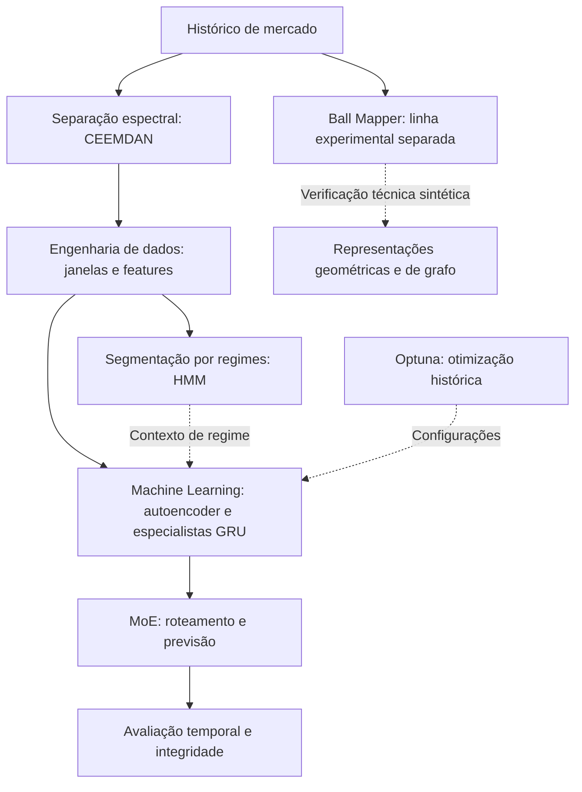

# Arquitetura por blocos

[← Apresentação](README.md)

O projeto combina três frentes de trabalho: **separação espectral**, **engenharia de dados** e **Machine Learning**. Essa organização mostra o problema que cada componente procura resolver, sem expor a receita de implementação.

## 1 · Separação espectral — CEEMDAN

**Responsabilidade:** decompor a série temporal em componentes que representam diferentes escalas de variação.

**Por quê:** o movimento observado reúne oscilações de curto prazo e estruturas mais lentas. A decomposição permite trabalhar com essas escalas na construção da representação dos dados.

**Competências demonstradas:** processamento de sinais, decomposição adaptativa de séries e construção de representações para modelos temporais.

CEEMDAN integra a engenharia legada. Sua presença não demonstra, isoladamente, ganho preditivo; a proveniência integral das componentes históricas não foi certificada de ponta a ponta.

## 2 · Engenharia de dados — séries, regimes e geometria

| Componente | Papel | Motivo |
|---|---|---|
| Preparação de séries temporais | Organizar janelas, alinhar entradas e alvos e separar etapas cronológicas | Tornar o problema de previsão consistente e as comparações auditáveis |
| HMM | Segmentar a série em regimes latentes de mercado | Representar mudanças de contexto em vez de tratar todo o histórico como homogêneo |
| Ball Mapper | Explorar a geometria das trajetórias e atributos de sua representação em grafo | Investigar se a estrutura de vizinhança acrescenta informação útil aos modelos |

**Distinção de responsabilidades:** o HMM caracteriza regimes; o roteador do MoE seleciona especialistas. São componentes com papéis diferentes.

**Ball Mapper é uma linha experimental separada:** há implementação e verificações técnicas em dados sintéticos, mas não há resultado histórico de eficácia apresentado neste portfólio. Ele não compõe o MoE avaliado nos resultados publicados.

**Competências demonstradas:** engenharia de features, preparação temporal, modelagem de regimes e exploração de representações geométricas de dados.

## 3 · Machine Learning — representação, especialização e otimização

| Componente | Papel | Motivo |
|---|---|---|
| Autoencoder com GRU | Aprender uma representação sequencial por reconstrução antes da supervisão | Explorar estrutura temporal na etapa de pré-treinamento |
| Especialistas GRU | Estimar retornos em contextos distintos | Investigar respostas especializadas às mudanças do mercado |
| Mixture of Experts (MoE) | Coordenar o roteamento e as previsões dos especialistas | Organizar a especialização em uma arquitetura modular |
| Optuna | Apoiar a busca de hiperparâmetros no desenvolvimento histórico | Explorar configurações de forma sistemática |
| Objetivo supervisionado | Considerar erro de retorno e informação direcional | Alinhar o treinamento às dimensões avaliadas |
| Agregação entre inicializações | Combinar previsões de diferentes seeds | Avaliar uma saída agregada sem escolher a melhor inicialização |

O encoder permanece congelado na comparação controlada destacada. O uso de Optuna pertence ao desenvolvimento histórico; não implica que cada experimento posterior tenha realizado uma nova busca.

**Competências demonstradas:** aprendizado de representações, redes recorrentes, otimização de hiperparâmetros, arquiteturas com especialistas e desenho de objetivos de treinamento.

## Como as frentes se relacionam

Diagrama conceitual de responsabilidades. Ele não especifica todas as entradas, a ordem completa de execução ou uma integração aprovada entre todas as linhas.

## Validação que acompanha a arquitetura

A avaliação atravessa os três blocos: controles comparáveis, métricas de direção e regressão, diagnóstico por período, análise de incerteza e verificação dos artefatos persistidos.

Os três marcos e seus resultados permanecem na [apresentação](README.md) e em [resultados](RESULTS.md). O ramo TCN foi avaliado separadamente e não demonstrou benefício incremental que justificasse sua incorporação ao MoE.

Detalhes de features, hiperparâmetros, fórmulas de treinamento, regras exatas de roteamento e artefatos de implementação permanecem privados.
