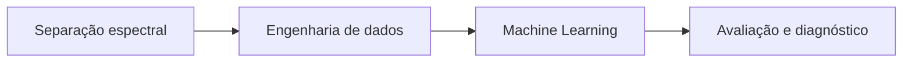

# Bitcoin ML Research

### Especialistas por regime. Evolução orientada por evidência. Complexidade que precisa se justificar.

Projeto de pesquisa e engenharia de Machine Learning desenvolvido no contexto de um TCC, voltado à previsão de retornos do Bitcoin. Integra redes temporais, especialização por contexto de mercado e avaliação cronológica para investigar uma pergunta prática: **o que cada novo componente realmente acrescenta?**

Este portfólio apresenta três marcos do trabalho, as decisões de arquitetura e resultados históricos selecionados. Código, dados, pesos e configurações de implementação permanecem privados.

## Três marcos em destaque

### 1 · Uma arquitetura que reconhece contextos diferentes

Construção de uma arquitetura de mistura de especialistas (*Mixture of Experts*): um bloco de roteamento seleciona especialistas temporais para diferentes regimes de mercado. Os especialistas utilizam representações aprendidas com GRU e uma etapa de pré-treinamento por reconstrução. A saída final agrega previsões de múltiplas inicializações.

**Por quê:** investigar especialização em um mercado cujo comportamento muda ao longo do tempo, preservando uma estrutura modular para comparar decisões de modelagem.

**Resultado de referência:** o controle histórico comparável atingiu **53,88% de acerto direcional** e **54,77% de acurácia balanceada** em 258 previsões. É o ponto de comparação do marco seguinte; esses números isolados não demonstram o benefício de cada bloco.

### 2 · Melhorar o treinamento antes de aumentar a rede

Revisão do objetivo supervisionado para incorporar informação direcional ao problema de regressão, mantendo a arquitetura e um controle com entradas e representação equivalentes.

**Resultado histórico:** acerto direcional de **55,81%**, acurácia balanceada de **56,73%** e RMSE de **0,070965**, frente a 53,88%, 54,77% e 0,072166 do controle. O ganho de acurácia balanceada foi de aproximadamente **1,96 ponto percentual**.

**Decisão:** manter a candidata para investigação posterior. O intervalo de 95% do ganho de acerto direcional inclui zero; a melhora é exploratória e varia entre períodos.

### 3 · Colocar a complexidade à prova em escala temporal

Avaliação de um ramo convolucional temporal (TCN), comparado com GRU, controles lineares e combinações com os especialistas. O estudo ampliou a avaliação para **25 folds de reajuste, cinco inicializações e 2.228 origens de previsão** na análise principal, totalizando **1.058 ajustes científicos** no experimento completo.

**Resultado e decisão:** uma combinação reduziu o MAE em cerca de **7,9%** frente ao respectivo MoE, mas um controle simples de redução da amplitude obteve praticamente a mesma melhora. **Não foi demonstrado benefício incremental que justificasse acrescentar a TCN ao MoE.** A receita foi arquivada, sem promoção operacional.

Esse marco demonstra comparação com baselines, análise de incerteza e capacidade de recusar complexidade quando a evidência não a sustenta.

## Arquitetura em três frentes

| Frente | Blocos de construção | Propósito |
|---|---|---|
| **Separação espectral** | CEEMDAN | Representar diferentes escalas de variação da série |
| **Engenharia de dados** | Preparação temporal, segmentação por HMM e exploração com Ball Mapper | Organizar sequências, caracterizar regimes e investigar a geometria das trajetórias |
| **Machine Learning** | Autoencoder, especialistas GRU, MoE e Optuna | Aprender representações, especializar previsões e explorar hiperparâmetros |

Visão conceitual das competências do projeto. **Ball Mapper pertence a uma linha experimental separada, com verificações técnicas sintéticas; não integra o MoE dos resultados publicados.** Optuna foi utilizado no desenvolvimento histórico, sem nova busca em cada comparação.

Veja [o papel e o motivo de cada bloco](ARCHITECTURE.md).

## Competências demonstradas

- **Processamento de sinais e dados:** CEEMDAN, preparação de séries, regimes HMM e exploração geométrica com Ball Mapper.
- **Modelagem e otimização:** GRU, autoencoders, mistura de especialistas, Optuna e avaliação de TCN.
- **Experimentação:** controles comparáveis, ablações e separação entre ganho aparente e contribuição incremental.
- **Avaliação:** acerto direcional, acurácia balanceada, erros de regressão e bootstrap em blocos.
- **Engenharia de ML:** execução em CPU/GPU, persistência e recarga de modelos, verificação de integridade e retomada de execuções.
- **Decisão técnica:** avançar, limitar ou arquivar componentes conforme a evidência disponível.

**Tecnologias utilizadas no projeto:** Python, TensorFlow/Keras, NumPy, pandas, scikit-learn, Optuna e CUDA.

## Leia os detalhes públicos

- [Arquitetura por blocos e motivos das escolhas](ARCHITECTURE.md)
- [Resultados, contexto de comparação e limites](RESULTS.md)

## Escopo da evidência

Os números são históricos e exploratórios. Os dois recortes apresentados têm protocolos e coberturas distintos e não formam um ranking único. Não há alegação de rentabilidade, vantagem operacional ou desempenho prospectivo comprovado.

Os registros técnicos originais permanecem privados; esta documentação resume resultados verificados nesses registros, sem disponibilizar reprodução pública. Não contém código executável, modelos, dados ou receitas de treinamento.

**Autor:** [Maurício Gutierrez](https://github.com/mauricioGutierrezz)
